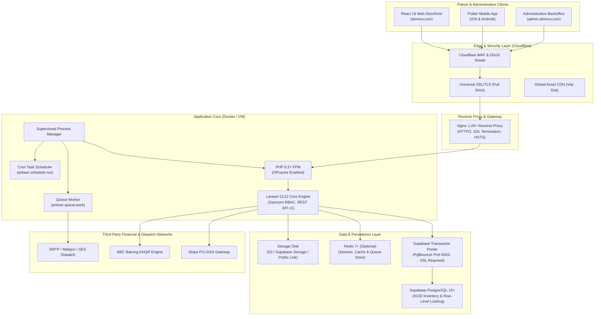

# Skinora Omnichannel E-Commerce & Dispensary
## Production Deployment Guide & System Operations Manual (Phase 12)

---

## 1. System Architecture & Topology Overview

Skinora is an enterprise-grade omnichannel skincare platform integrating a **Laravel 11/12 REST API & Administrative Backoffice**, a **React 19 Vite Web Storefront**, a **Flutter Mobile Application**, and a **Supabase PostgreSQL** cloud database.



---

## 2. Production Environment Configuration & Secret Management

### A. Secret Hygiene & Zero-Commit Policy
> [!CAUTION]
> Never commit `.env`, `.env.production`, private keys, SSL certificates, or API secrets into version control. Ensure `.env` is listed in `.gitignore` across all sub-repositories.

### B. Laravel Backend Production Configuration (`.env.production`)
Create the production environment file on the server at `/var/www/skinora/backend/.env`:

```ini
# ==============================================================================
# SKINORA BACKEND — PRODUCTION ENVIRONMENT
# ==============================================================================
APP_NAME="Skinora Dispensary"
APP_ENV=production
APP_KEY=base64:GENERATE_VIA_ARTISAN_KEY_GENERATE
APP_DEBUG=false
APP_URL=https://api.skinora.com

APP_LOCALE=en
APP_FALLBACK_LOCALE=en
APP_TIMEZONE=Asia/Phnom_Penh

APP_MAINTENANCE_DRIVER=file
BCRYPT_ROUNDS=12

# ------------------------------------------------------------------------------
# LOGGING & SENTRY MONITORING
# ------------------------------------------------------------------------------
LOG_CHANNEL=daily
LOG_LEVEL=warning
LOG_STACK=single

SENTRY_LARAVEL_DSN=https://examplePublicKey@o0.ingest.sentry.io/0
SENTRY_TRACES_SAMPLE_RATE=0.2

# ------------------------------------------------------------------------------
# SUPABASE POSTGRESQL (PGBOUNCER TRANSACTION POOLER)
# ------------------------------------------------------------------------------
DB_CONNECTION=pgsql
DB_HOST=aws-0-ap-southeast-1.pooler.supabase.com
DB_PORT=6543
DB_DATABASE=postgres
DB_USERNAME=postgres.YOUR_PROJECT_REF
DB_PASSWORD=YOUR_STRONG_SUPABASE_PASSWORD
DB_SSLMODE=require

# ------------------------------------------------------------------------------
# CORS & SESSION DOMAIN CONFIGURATION
# ------------------------------------------------------------------------------
CORS_ALLOWED_ORIGINS="https://skinora.com,https://www.skinora.com,https://admin.skinora.com"
CORS_SUPPORTS_CREDENTIALS=true

SANCTUM_STATEFUL_DOMAINS="skinora.com,www.skinora.com,admin.skinora.com"
SESSION_DOMAIN=".skinora.com"
SESSION_SECURE_COOKIE=true
SESSION_DRIVER=database
SESSION_LIFETIME=120

# ------------------------------------------------------------------------------
# CACHE, QUEUES & TASK SCHEDULING
# ------------------------------------------------------------------------------
CACHE_STORE=database
CACHE_PREFIX=skinora_prod_cache_
QUEUE_CONNECTION=database

# ------------------------------------------------------------------------------
# TRANSACTIONAL EMAIL (ORDER CONFIRMATIONS & DISPATCH)
# ------------------------------------------------------------------------------
MAIL_MAILER=smtp
MAIL_HOST=smtp.mailgun.org
MAIL_PORT=587
MAIL_USERNAME=postmaster@skinora.com
MAIL_PASSWORD=YOUR_MAILGUN_SMTP_PASSWORD
MAIL_ENCRYPTION=tls
MAIL_FROM_ADDRESS="apothecary@skinora.com"
MAIL_FROM_NAME="Skinora Dispensary"

# ------------------------------------------------------------------------------
# STORAGE & ASSET DISPATCH
# ------------------------------------------------------------------------------
FILESYSTEM_DISK=public
AWS_ACCESS_KEY_ID=YOUR_AWS_ACCESS_KEY
AWS_SECRET_ACCESS_KEY=YOUR_AWS_SECRET_KEY
AWS_DEFAULT_REGION=ap-southeast-1
AWS_BUCKET=skinora-assets
AWS_URL=https://skinora-assets.s3.ap-southeast-1.amazonaws.com

# ------------------------------------------------------------------------------
# PAYMENT PROVIDER PRODUCTION GATEWAYS
# ------------------------------------------------------------------------------
STRIPE_KEY=pk_live_YOUR_STRIPE_LIVE_PUBLISHABLE_KEY
STRIPE_SECRET=sk_live_YOUR_STRIPE_LIVE_SECRET_KEY
STRIPE_WEBHOOK_SECRET=whsec_YOUR_LIVE_WEBHOOK_SIGNING_SECRET

BAKONG_MERCHANT_ID=SKINORA_DISPENSARY_LAB
BAKONG_MERCHANT_NAME="Skinora Dispensary"
BAKONG_MERCHANT_CITY="Phnom Penh"
BAKONG_API_KEY=YOUR_LIVE_BAKONG_TOKEN
BAKONG_API_URL=https://api-bakong.nbc.org.kh/v1

# ------------------------------------------------------------------------------
# TELEMETRY (DISABLED IN PRODUCTION)
# ------------------------------------------------------------------------------
PULSE_ENABLED=false
TELESCOPE_ENABLED=false
NIGHTWATCH_ENABLED=false
```

### C. React Frontend Production Configuration (`.env.production`)
Place in `Frontend_SkinCare_Ecommerce/.env.production`:

```ini
# Canonical production API base URL pointing to the /api/v1 prefix
VITE_API_BASE_URL=https://api.skinora.com/api/v1
VITE_APP_NAME="Skinora Clinical Dispensary"
VITE_ENABLE_ANALYTICS=true
VITE_GA_TRACKING_ID=G-XXXXXXXXXX
```

### D. Secret Provisioning in Cloud Environments (Render, Railway, Forge)
When using containerized cloud platforms (e.g., Render, Railway, AWS ECS):
1. Navigate to the **Environment** settings of the service.
2. Add all variables marked with `YOUR_` above as encrypted secret environment variables.
3. In `render.yaml`, set `sync: false` on sensitive credentials (e.g. `DB_PASSWORD`, `STRIPE_SECRET`) so they must be entered through the secure web vault.

---

## 3. HTTPS & Domain Configuration

### A. Recommended Domain Mapping Architecture
| Subdomain | Target Service | Hosting Platform |
| :--- | :--- | :--- |
| `skinora.com` | React 19 Frontend Web Storefront | Cloudflare Pages / Vercel / Nginx |
| `www.skinora.com` | Redirect to apex `https://skinora.com` | Cloudflare Page Rule (301) |
| `api.skinora.com` | Laravel REST API v1 (`/api/v1`) | Docker / Linux VM / Render |
| `admin.skinora.com` | Laravel POS & Backoffice Dashboard | Linux VM / Docker (Same backend host) |

### B. Cloudflare Edge SSL/TLS Configuration
1. **SSL/TLS Encryption Mode**: Set to **Full (Strict)**. This ensures end-to-end encryption between Cloudflare edge servers and your Nginx origin server.
2. **Edge Certificates**:
   - Enable **Always Use HTTPS** (Automatic 301 redirection).
   - Enable **HTTP Strict Transport Security (HSTS)** with:
     - `max-age=31536000` (1 Year)
     - `includeSubDomains`
     - `preload`
   - Set **Minimum TLS Version** to `TLS 1.2` (TLS 1.3 enabled by default).
   - Enable **Automatic HTTPS Rewrites**.

### C. Production Nginx Server Block (`/etc/nginx/sites-available/api.skinora.com`)
```nginx
server {
    listen 80;
    listen [::]:80;
    server_name api.skinora.com admin.skinora.com;
    return 301 https://$host$request_uri;
}

server {
    listen 443 ssl http2;
    listen [::]:443 ssl http2;
    server_name api.skinora.com admin.skinora.com;

    root /var/www/skinora/backend/public;
    index index.php index.html;

    # SSL Certificates (Let's Encrypt Certbot)
    ssl_certificate /etc/letsencrypt/live/api.skinora.com/fullchain.pem;
    ssl_certificate_key /etc/letsencrypt/live/api.skinora.com/privkey.pem;
    ssl_protocols TLSv1.2 TLSv1.3;
    ssl_ciphers HIGH:!aNULL:!MD5;
    ssl_prefer_server_ciphers on;
    ssl_session_cache shared:SSL:10m;
    ssl_session_timeout 1d;

    # Security Headers
    add_header X-Frame-Options "SAMEORIGIN" always;
    add_header X-Content-Type-Options "nosniff" always;
    add_header X-XSS-Protection "1; mode=block" always;
    add_header Strict-Transport-Security "max-age=31536000; includeSubDomains; preload" always;
    add_header Referrer-Policy "strict-origin-when-cross-origin" always;

    # Upload Size Limits
    client_max_body_size 25M;

    # Healthcheck bypass
    location = /up {
        access_log off;
        try_files $uri /index.php?$query_string;
    }

    # Static Assets & Storage Link Caching
    location ~* \.(jpg|jpeg|png|gif|ico|css|js|webp|svg|woff2)$ {
        expires 30d;
        add_header Cache-Control "public, no-transform";
        access_log off;
        try_files $uri $uri/ /index.php?$query_string;
    }

    location / {
        try_files $uri $uri/ /index.php?$query_string;
    }

    location ~ \.php$ {
        fastcgi_pass unix:/var/run/php/php8.2-fpm.sock;
        fastcgi_index index.php;
        fastcgi_param SCRIPT_FILENAME $realpath_root$fastcgi_script_name;
        include fastcgi_params;
        fastcgi_hide_header X-Powered-By;
        fastcgi_buffers 16 16k;
        fastcgi_buffer_size 32k;
        fastcgi_read_timeout 60s;
    }

    location ~ /\.(?!well-known).* {
        deny all;
    }
}
```

---

## 4. Production CORS Settings

The Cross-Origin Resource Sharing (CORS) rules in `config/cors.php` are dynamic and read from `CORS_ALLOWED_ORIGINS`:

```php
return [
    'paths' => ['api/*', 'sanctum/csrf-cookie'],
    'allowed_methods' => ['*'],
    'allowed_origins' => env('CORS_ALLOWED_ORIGINS')
        ? array_filter(array_map('trim', explode(',', env('CORS_ALLOWED_ORIGINS'))))
        : ['*'],
    'allowed_origins_patterns' => [],
    'allowed_headers' => ['*'],
    'exposed_headers' => [],
    'max_age' => 86400, // 24-hour pre-flight OPTIONS cache
    'supports_credentials' => (bool) env('CORS_SUPPORTS_CREDENTIALS', false),
];
```

### Pre-Flight Verification
Verify that pre-flight headers are correctly returned:
```bash
curl -I -X OPTIONS https://api.skinora.com/api/v1/store/settings \
  -H "Origin: https://skinora.com" \
  -H "Access-Control-Request-Method: GET"
```
**Expected Response:**
```http
HTTP/2 204
access-control-allow-origin: https://skinora.com
access-control-allow-methods: *
access-control-allow-credentials: true
access-control-max-age: 86400
```

---

## 5. Database Backups, Migrations & Supabase Configuration

### A. Supabase PostgreSQL Architecture
- **Transaction Pooler (PgBouncer)**: `aws-0-ap-southeast-1.pooler.supabase.com` on **Port 6543**.
- **Important**: In `config/database.php`, `prepared_statements => false` is configured because PgBouncer in transaction pooling mode cannot maintain prepared statements across client socket switches.
- **SSL Requirement**: `DB_SSLMODE=require` must be set in production to encrypt all SQL traffic between Laravel and Supabase.

### B. Production Migration Execution Procedure
Run migrations during deployment using the non-interactive `--force` flag:

```bash
# 1. Inspect pending migrations first
php artisan migrate:status

# 2. Execute pending migrations with atomic safety
php artisan migrate --force
```

> [!IMPORTANT]
> **Zero-Downtime Migration Rule**: Never drop a column or rename a table in a single deployment while existing application instances are actively handling traffic. Use the expand-contract pattern:
> 1. Add new columns as nullable.
> 2. Deploy updated application code writing to both.
> 3. Backfill historical records.
> 4. Drop deprecated columns in a follow-up deployment.

### C. Automated Database Backup Routine
Set up a daily automated database dump on your management host using `pg_dump`:

```bash
#!/usr/bin/env bash
# /usr/local/bin/backup-skinora-db.sh
set -e

TIMESTAMP=$(date +"%Y%m%d_%H%M%S")
BACKUP_DIR="/var/backups/skinora/db"
BACKUP_FILE="${BACKUP_DIR}/skinora_backup_${TIMESTAMP}.sql.gz"

mkdir -p "${BACKUP_DIR}"

export PGPASSWORD="YOUR_STRONG_SUPABASE_PASSWORD"
pg_dump -h aws-0-ap-southeast-1.pooler.supabase.com \
        -p 6543 \
        -U postgres.YOUR_PROJECT_REF \
        -d postgres \
        --clean \
        --if-exists \
        --no-owner \
        --no-privileges | gzip > "${BACKUP_FILE}"

echo "[Database Backup] Successfully created: ${BACKUP_FILE}"

# Sync to secure S3 storage bucket
aws s3 cp "${BACKUP_FILE}" s3://skinora-db-backups/daily/

# Retain local backups for 14 days
find "${BACKUP_DIR}" -type f -name "*.sql.gz" -mtime +14 -delete
```

### D. Disaster Recovery Database Restoration Procedure
In the event of database failure or corrupted ledger state:

```bash
# 1. Put Laravel into maintenance mode
php artisan down --secret="skinora-emergency-bypass-2026"

# 2. Decompress and restore SQL dump
gunzip -c /var/backups/skinora/db/skinora_backup_YYYYMMDD_HHMMSS.sql.gz | \
psql -h aws-0-ap-southeast-1.pooler.supabase.com \
     -p 6543 \
     -U postgres.YOUR_PROJECT_REF \
     -d postgres

# 3. Re-run migrations to ensure schema alignment
php artisan migrate --force

# 4. Clear and rebuild application caches
php artisan optimize:clear
php artisan optimize

# 5. Bring application back online
php artisan up
```

---

## 6. Queue Workers, Scheduled Tasks, Email & Storage

### A. Queue Worker Configuration (Supervisord)
Laravel handles order confirmation emails, inventory alerts, and payment verification asynchronously via queues.

Create `/etc/supervisor/conf.d/skinora-worker.conf`:
```ini
[program:skinora-worker]
process_name=%(program_name)s_%(process_num)02d
command=php /var/www/skinora/backend/artisan queue:work database --sleep=3 --tries=3 --max-time=3600 --timeout=90
autostart=true
autorestart=true
stopasgroup=true
killasgroup=true
user=www-data
numprocs=2
redirect_stderr=true
stdout_logfile=/var/log/supervisor/skinora-worker.log
stopwaitsecs=3600
```

Start the supervisor workers:
```bash
sudo supervisorctl reread
sudo supervisorctl update
sudo supervisorctl start skinora-worker:*
```

### B. Scheduled Tasks (Cron Configuration)
Add the single Laravel heartbeat cron job to the server's crontab (`crontab -e -u www-data`):

```cron
* * * * * cd /var/www/skinora/backend && php artisan schedule:run >> /dev/null 2>&1
```

Scheduled jobs managed by Laravel:
- Daily inventory threshold health scan.
- Auto-cancellation of abandoned checkout sessions older than 24 hours.
- Daily sales aggregation for executive report caches.

### C. Email Configuration (SMTP / SPF / DKIM / DMARC)
Ensure your domain DNS has valid authentication records:
- **SPF**: `v=spf1 include:mailgun.org ~all`
- **DKIM**: Add the TXT selector record provided by your email delivery provider.
- **DMARC**: `v=DMARC1; p=quarantine; rua=mailto:dmarc-reports@skinora.com`

Test transactional email delivery:
```bash
php artisan tinker --execute="Mail::raw('Skinora Production Mail Test', fn(\$m) => \$m->to('your-email@example.com')->subject('Production Dispatch Test'));"
```

### D. File Storage Configuration
Ensure the public storage directory is symlinked and writeable:
```bash
cd /var/www/skinora/backend
php artisan storage:link

sudo chown -R www-data:www-data storage bootstrap/cache
sudo chmod -R 775 storage bootstrap/cache
```

---

## 7. Frontend Production Build & Laravel Optimization Commands

### A. React Frontend Build (`Frontend_SkinCare_Ecommerce`)
```bash
# 1. Navigate to frontend directory
cd Frontend_SkinCare_Ecommerce

# 2. Install dependencies cleanly
npm ci

# 3. Run production build with Vite
npm run build
```
The output files in `Frontend_SkinCare_Ecommerce/dist` are ready for deployment to Cloudflare Pages, AWS S3/CloudFront, Netlify, or Nginx.

### B. Laravel Backend Optimization Sequence
Execute this deployment script after every code update:

```bash
cd /var/www/skinora/backend

# 1. Activate maintenance mode with secret bypass token
php artisan down --secret="skinora-deploy-2026"

# 2. Pull latest release code
git pull origin main

# 3. Install production composer dependencies (no dev, optimized classmap)
composer install --no-dev --no-interaction --prefer-dist --optimize-autoloader --classmap-authoritative

# 4. Run database migrations
php artisan migrate --force

# 5. Clear stale caches
php artisan optimize:clear

# 6. Rebuild production caches
php artisan config:cache
php artisan route:cache
php artisan view:cache
php artisan event:cache

# 7. Restart queue workers gracefully
php artisan queue:restart

# 8. Deactivate maintenance mode
php artisan up
```

### C. Recommended Production PHP OPcache Settings (`/etc/php/8.2/fpm/conf.d/10-opcache.ini`)
```ini
opcache.enable=1
opcache.enable_cli=0
opcache.memory_consumption=128
opcache.interned_strings_buffer=8
opcache.max_accelerated_files=10000
opcache.revalidate_freq=0
opcache.validate_timestamps=0
```
> [!NOTE]
> When `opcache.validate_timestamps=0` is set, PHP never checks files for changes, ensuring maximum performance. Reload PHP-FPM (`sudo systemctl reload php8.2-fpm`) after every deployment to clear cached bytecode.

---

## 8. Logging, Monitoring, Health Checks & Rate Limits

### A. Healthcheck Endpoint (`/up`)
The Laravel application exposes a lightweight health check endpoint at `https://api.skinora.com/up`.
- Responds with `HTTP 200 OK` when the application is functional.
- Used by Render, Docker, Kubernetes, and Cloudflare health monitors.
- Configure monitoring services (e.g. UptimeRobot, Pingdom, BetterStack) to poll `https://api.skinora.com/up` every 60 seconds.

### B. API Rate Limiting Architecture
Configured in `routes/api.php`:
- **Storefront Endpoints (`/api/v1/store/*`)**: `throttle:120,1` (120 requests per minute per IP address).
- **Cart & Quoting (`/api/v1/cart/quote`)**: `throttle:60,1` (60 requests per minute).
- **Authentication (`/api/v1/customer/login`, `/register`)**: `throttle:10,1` (10 attempts per minute to mitigate credential stuffing).
- **Payment Verification (`/api/v1/orders/{order}/verify-payment`)**: `throttle:30,1`.

When a rate limit is exceeded, the API returns:
```json
{
  "message": "Too Many Attempts.",
  "status": 429
}
```

### C. Error Logging & Exception Handling
- Logs are written to `/var/www/skinora/backend/storage/logs/laravel-YYYY-MM-DD.log`.
- Sensitive parameters (`password`, `password_confirmation`, `card_number`, `cvv`) are masked automatically.
- Ensure log rotation is enabled via `LOG_CHANNEL=daily` (retains 14 days by default).

---

## 9. Secure Admin Access & Operational Procedures

### A. Initial Administrator Provisioning
Create the primary administrator account using Artisan:

```bash
php artisan tinker --execute="
App\Models\User::firstOrCreate(
    ['email' => 'admin@skinora.com'],
    [
        'name' => 'Master Apothecary Administrator',
        'password' => bcrypt('REPLACE_WITH_VERY_STRONG_PASSWORD'),
        'role' => 'admin',
        'status' => 'active'
    ]
);"
```

### B. Admin Security Safeguards
1. **Self-Deactivation Guard**: The administrative controller strictly forbids an administrator from deactivating their own account, preventing accidental lockouts.
2. **Role-Based Access Control (RBAC)**:
   - `admin`: Complete system control, reports, inventory adjustments, user management, and system settings.
   - `manager`: Catalog, customer CRM, stock transfers, inventory reporting.
   - `cashier`: Point of Sale terminal and customer order lookup only; forbidden from management modules and administrative settings.
3. **Account Recovery**: Password reset emails are dispatched with signed cryptographic tokens expiring after 60 minutes (`POST /api/v1/customer/forgot-password`).

---

## 10. Payment Providers & Webhook Configuration

### A. Stripe Production Setup
1. In the **Stripe Dashboard**:
   - Complete business profile verification.
   - Enable Credit/Debit Card payment methods.
   - Add a webhook destination: `https://api.skinora.com/api/v1/payments/stripe/webhook`.
   - Listen for events:
     - `payment_intent.succeeded`
     - `payment_intent.payment_failed`
     - `charge.refunded`
2. Copy the **Signing Secret** (`whsec_...`) into `.env` as `STRIPE_WEBHOOK_SECRET`.
3. In code, all webhooks verify the signature before processing:
   ```php
   $event = \Stripe\Webhook::constructEvent($payload, $sigHeader, config('services.stripe.webhook_secret'));
   ```

### B. Bakong KHQR (Cambodia Pay) Production Setup
1. Register the commercial merchant account with the National Bank of Cambodia (NBC) or partner bank (ABA Bank, ACLEDA, Canadia).
2. Configure merchant credentials in `.env`:
   - `BAKONG_MERCHANT_ID=SKINORA_DISPENSARY_LAB`
   - `BAKONG_API_KEY=YOUR_NBC_TOKEN`
3. Dynamic QR generation is routed through `POST /api/v1/orders/{order}/verify-payment` to verify status on the banking network before finalizing order state.

### C. Cash on Delivery (COD) Rules
- COD orders are saved with `payment_type = 'cash'` and `payment_status = 'pending'`.
- The order status is automatically initialized to `'confirmed'` so dispensary staff can prepare formulation packaging.
- Courier settles cash upon arrival and cashier marks status as `'paid'` in the backoffice POS.

---

## 11. Rollback, Restore & Troubleshooting Procedures

### A. Fast Emergency Rollback
If a newly deployed code release causes critical regressions:

```bash
cd /var/www/skinora/backend

# 1. Rollback code to the previous git tag or commit
git reset --hard HEAD~1

# 2. If database schema was altered, rollback the last batch
php artisan migrate:rollback --step=1

# 3. Clear and regenerate caches
php artisan optimize:clear
php artisan optimize

# 4. Reload PHP-FPM
sudo systemctl reload php8.2-fpm
php artisan queue:restart
```

### B. Common Production Issues & Resolutions

| Issue / Error | Root Cause | Resolution |
| :--- | :--- | :--- |
| **HTTP 500: Server Error** | Missing `.env`, invalid `APP_KEY`, or permissions issue | Check `storage/logs/laravel.log`. Run `php artisan key:generate`. Verify `chmod -R 775 storage bootstrap/cache`. |
| **CORS Preflight Blocked** | `CORS_ALLOWED_ORIGINS` does not match client origin | Add exact protocol and domain to `CORS_ALLOWED_ORIGINS` in `.env` (e.g. `https://skinora.com`). Run `php artisan config:cache`. |
| **Database Connection Timeout (6543)** | Supabase pooler blocked or connection limit reached | Confirm port is `6543`, `DB_SSLMODE=require`, and `prepared_statements=false`. Check Supabase project status. |
| **HTTP 419: Page Expired (CSRF)** | Session domain mismatch or expired token | Ensure `SESSION_DOMAIN=.skinora.com` and `SESSION_SECURE_COOKIE=true` for HTTPS. Check clock synchronization on server (`timedatectl`). |
| **Public Storage 404 for Product Images** | Symlink missing or pointing to wrong path | Run `php artisan storage:link`. Verify file exists in `storage/app/public/products/`. Check Nginx static location block. |
| **Queues Not Processing Emails** | Supervisor daemon stopped or database table locked | Check worker logs: `sudo supervisorctl status`. Run `php artisan queue:restart`. Inspect `failed_jobs` table via `php artisan queue:failed`. |

---

## 12. Complete REST API Reference (`/api/v1`)

| Module | Method | URI | Description | Auth Required |
| :--- | :---: | :--- | :--- | :---: |
| **Storefront** | `GET` | `/api/v1/store/settings` | Multi-currency, tax rate, and active payment gateways | Public |
| | `GET` | `/api/v1/store/categories` | Active skincare categories with product counts | Public |
| | `GET` | `/api/v1/store/brands` | Brand directory and product counts | Public |
| | `GET` | `/api/v1/store/products` | Paginated catalog with search, price, category filters | Public |
| | `GET` | `/api/v1/store/products/featured` | Curated laboratory featured formulations | Public |
| | `GET` | `/api/v1/store/products/bestsellers` | Top-selling clinical skincare formulations | Public |
| | `GET` | `/api/v1/store/products/new-arrivals` | Latest formulation releases | Public |
| | `GET` | `/api/v1/store/products/{id}` | Detailed formulation view, ingredients, benefits | Public |
| | `GET` | `/api/v1/store/products/{id}/reviews` | Customer ratings, reviews, and verified buyer badges | Public |
| | `GET` | `/api/v1/store/promotions` | Active discount promotions and banner campaigns | Public |
| **Cart** | `POST` | `/api/v1/cart/quote` | Authoritative quote (subtotal, promo, 5% tax, shipping) | Public / Guest |
| **Auth** | `POST` | `/api/v1/customer/register` | Customer account registration | Public |
| | `POST` | `/api/v1/customer/login` | Email/password login returning Sanctum bearer token | Public |
| | `POST` | `/api/v1/customer/forgot-password` | Dispatches password reset link | Public |
| | `POST` | `/api/v1/customer/reset-password` | Sets new password with reset token | Public |
| | `GET` | `/api/v1/customer/profile` | Customer profile, loyalty tier, and points balance | Bearer Token |
| | `PUT` | `/api/v1/customer/profile` | Updates profile name, phone, or address | Bearer Token |
| | `PUT` | `/api/v1/customer/password` | Changes password with current password verification | Bearer Token |
| | `POST` | `/api/v1/customer/logout` | Revokes current Sanctum bearer token | Bearer Token |
| **Addresses** | `GET` | `/api/v1/customer/addresses` | Saved customer destination address book | Bearer Token |
| | `POST` | `/api/v1/customer/addresses` | Creates new destination address | Bearer Token |
| | `PUT` | `/api/v1/customer/addresses/{id}` | Updates existing address (with IDOR protection) | Bearer Token |
| | `DELETE`| `/api/v1/customer/addresses/{id}` | Removes destination address | Bearer Token |
| | `POST` | `/api/v1/customer/addresses/{id}/default` | Sets primary default shipping destination | Bearer Token |
| **Wishlist** | `GET` | `/api/v1/customer/wishlist` | Authenticated customer favorite formulations | Bearer Token |
| | `POST` | `/api/v1/customer/wishlist/toggle` | Adds or removes product from saved wishlist | Bearer Token |
| **Checkout** | `POST` | `/api/v1/customer/checkout` | Order placement with idempotency protection | Public / Token |
| **Orders** | `GET` | `/api/v1/customer/orders` | Customer order history with fulfillment statuses | Bearer Token |
| | `GET` | `/api/v1/customer/orders/{order}` | Detailed order invoice, tracking code, item list | Bearer Token |
| | `POST` | `/api/v1/customer/orders/{order}/cancel`| Cancels pending order & automatically restocks qty | Bearer Token |
| | `POST` | `/api/v1/orders/track` | Public order tracking via invoice & contact phone | Public |
| **Payment** | `POST` | `/api/v1/orders/{order}/verify-payment`| Authoritative payment confirmation check | Public / Token |
| | `POST` | `/api/v1/payments/stripe/webhook` | Stripe asynchronous webhook confirmation | Signature |

---

## 13. Local Development Quickstart (Windows PowerShell)

To spin up the entire Skinora development environment locally:

```powershell
# ------------------------------------------------------------------------------
# 1. Start Laravel Backend (Port 8000)
# ------------------------------------------------------------------------------
Set-Location C:\Users\phanet\Documents\SkinCare_Ecommerce\Backend_SkinCare_Ecommerce
php artisan serve --port=8000

# ------------------------------------------------------------------------------
# 2. Start React Web Storefront (Port 5173)
# ------------------------------------------------------------------------------
Set-Location C:\Users\phanet\Documents\SkinCare_Ecommerce\Frontend_SkinCare_Ecommerce
npm run dev

# ------------------------------------------------------------------------------
# 3. Start Skinora Flutter Mobile Application
# ------------------------------------------------------------------------------
Set-Location C:\Users\phanet\Documents\SkinCare_Ecommerce\skinora-mobile
flutter run
```

---

## 14. Production Readiness Audit & Deployment Checklist

The deployment status is clearly categorized below to separate **verified software functionality** from **infrastructure tasks requiring manual production provisioning**:

### Section A: Verified Software Functionality (100% Passing Automated Tests)
- [x] **Backend Test Suite**: All **142 tests (1,065 assertions)** passed (`php artisan test`).
- [x] **Frontend Production Build**: Vite built `dist/` successfully with code splitting and minified assets (`npm run build`).
- [x] **Mobile Test Suite**: All **133 unit and widget tests** passed (`flutter test`).
- [x] **Static Code Analysis**: **0 errors / 0 warnings** found on `flutter analyze`.
- [x] **Database Schema & Migrations**: PostgreSQL & SQLite migration compatibility verified.
- [x] **Sanctum RBAC**: Multi-role authorization (`admin`, `manager`, `cashier`, `customer`) tested.
- [x] **Idempotency Safeguards**: Tested duplicate order prevention with `idempotency_key`.
- [x] **Cash on Delivery Flow**: Verified pending payment status and confirmed order creation.
- [x] **PCI-DSS Compliance**: Client applications handle card numbers strictly in memory with zero persistence.

### Section B: Tasks Requiring Manual Infrastructure & Merchant Setup
- [ ] **Domain & DNS Setup**: Register `skinora.com` and configure DNS records (`A`, `CNAME`) pointing to host server.
- [ ] **Cloudflare SSL/TLS**: Enable Cloudflare Full (Strict) mode and configure HSTS.
- [ ] **Production Secret Keys**:
  - Run `php artisan key:generate --show` on the production server to generate a unique `APP_KEY`.
  - Set `APP_DEBUG=false` in the live `.env`.
- [ ] **Supabase Production Database**:
  - Verify project credentials on the Supabase dashboard.
  - Set `DB_PASSWORD` in the server environment vault.
- [ ] **Live Payment Gateways**:
  - Obtain live production API keys from the **Stripe Dashboard** (`pk_live_...`, `sk_live_...`).
  - Register commercial merchant account with **NBC Bakong** to obtain live production KHQR credentials.
  - Configure live webhook URL (`https://api.skinora.com/api/v1/payments/stripe/webhook`) in the Stripe Dashboard.
- [ ] **Production SMTP Mailer**: Configure credentials for Mailgun, AWS SES, or Resend.
- [ ] **Supervisor & Cron Daemon**: Enable `skinora-worker` and crontab on the host server.

> [!IMPORTANT]
> **Deployment Status**: The software codebase is fully verified, optimized, and ready for deployment. Deployment has **not** been executed to a live public server. The system must not be represented as deployed until production DNS, SSL certificates, and hosting provisioning are complete.
